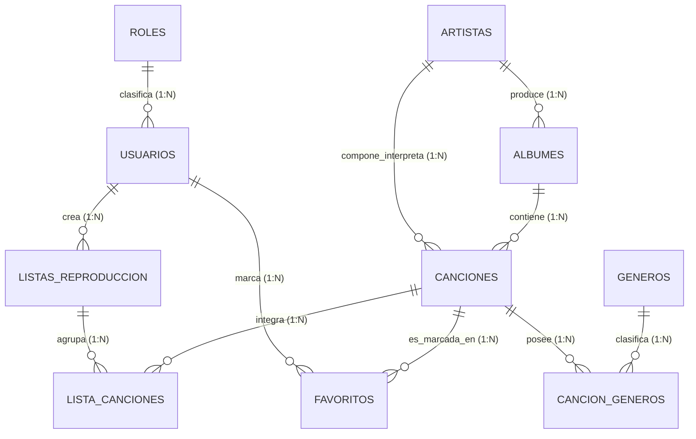

# 󰎆 MusicLab — Sistema Académico Relacional de Gestión Musical

> **Trabajo Colaborativo Contextualizado (TCC) — Bases de Datos II**  
> **Universidad de Cartagena — Centro para la Educación Virtual y a Distancia (CTEV)**  
> **Propuesta para la comunidad musical:** *Corporación Musical y Colectivo de Artistas Independientes del Caribe "Sonoridades Locales"* *(referencia provisional; reemplace por la entidad real de su localidad si la actividad lo exige)*.

---

## 1. Descripción del Proyecto

**MusicLab** es una plataforma web académica integral y modular con base de datos relacional MySQL normalizada (1FN, 2FN y 3FN), backend API REST en Node.js/Express y frontend reactivo en React + TypeScript con estilizado Tailwind CSS.

El sistema adopta una estética retro inspirada en la paleta cromática **Tokyo Night Storm** y la disposición de búferes del editor **LazyVim / Neovim**, facilitando tanto la administración de catálogos como la evaluación docente mediante atajos de teclado y consola SQL interactiva.

### Características Principales:
- **Base de Datos Relacional Normalizada:** 10 tablas interrelacionadas con claves primarias autonuméricas, claves foráneas, restricciones de chequeo (`CHECK`), índices de alto rendimiento (`B-Tree`) y borrado en cascada (`ON DELETE CASCADE`).
- **Reproducción de Música Real con Proveedores Externos:** Fuente de canciones **por defecto de proveedores como YouTube** mediante streaming nativo con la API IFrame, con capacidad extensible para **SoundCloud**, **Spotify** y **enlaces directos (MP3/OGG)**. Cumple el principio de arquitectura desacoplada: almacena metadatos y referencias en la base de datos, evitando saturarla con archivos pesados.
- **Control de Acceso Basado en Roles (RBAC):**
  - **Administrador:** Visualización, búsqueda multicriterio, inserción, actualización, eliminación física y ejecución en consola SQL.
  - **Solo consulta:** Visualización y búsqueda multicriterio, con denegación preventiva de operaciones de modificación (`403 Forbidden`).
- **Mecanismos para Extracción y Análisis de Información:**
  - Exportación estructurada a formato tabular plano **CSV**.
  - Exportación relacional jerárquica a **JSON**.
  - Subconsultas complejas con `IN`, subconsultas correlacionadas con `EXISTS`, agrupaciones con `GROUP BY` y condiciones de grupo con `HAVING`.
  - Panel de Indicadores Clave de Rendimiento (KPIs) de catálogo y duración acumulada.
- **Seguridad Criptográfica:** Contraseñas hasheadas con sal criptográfica única de 32 bytes (`Salt + SHA-256`), tokens de sesión `JWT` y **consultas 100% parametrizadas** con marcadores posicionales (`?`) para neutralizar la inyección SQL.
- **Alojamiento Dual (Full-Stack y GitHub Pages):** Servidor Express + Vite en desarrollo local y motor relacional autónomo en cliente (`localStorage`) para despliegue estático sin servidor en **GitHub Pages**.

---

## 2. Credenciales de Demostración y Prueba

Para evaluar los dos perfiles de usuario requeridos en la guía académica:

| Rol | Correo Electrónico | Contraseña | Permisos |
| :--- | :--- | :--- | :--- |
| **Administrador** | `admin@musiclab.local` | `Admin123!` | Lectura, inserción, edición, eliminación y consola DDL/DML |
| **Solo consulta** | `lector@musiclab.local` | `Lector123!` | Solo visualización y búsqueda multicriterio |

*Nota:* Puede alternar entre perfiles con un solo clic usando los botones **Rol Demo (Admin / Consulta)** situados en la barra superior. Además, puede registrar nuevos usuarios desde el botón **"Crear Usuario"** o la pestaña de registro del modal de login.

---

## 3. Modelo de Base de Datos MySQL

### 3.1. Tablas y Entidades (10 Tablas)
1. `roles`: Perfiles de acceso (`Administrador`, `Solo consulta`).
2. `usuarios`: Cuentas con hash criptográfico, sal y rol foráneo.
3. `artistas`: Músicos, compositores y bandas con país de origen e índices de búsqueda.
4. `albumes`: Producciones discográficas con clave foránea hacia artistas (`ON DELETE CASCADE`).
5. `generos`: Catálogo maestro de estilos y corrientes musicales.
6. `canciones`: Núcleo del catálogo con metadatos, duración, proveedor de audio (`youtube`, `soundcloud`, etc.) y referencia URL.
7. `cancion_generos`: Tabla de asociación muchos a muchos ($N:M$) entre canciones y géneros.
8. `listas_reproduccion`: Colecciones creadas por los usuarios de la comunidad.
9. `lista_canciones`: Tabla de asociación $N:M$ con orden de secuencia para listas.
10. `favoritos`: Registro de preferencias de los usuarios ($N:M$).

### 3.2. Diagrama Entidad-Relación (Mermaid)



### 3.3. Script DDL y DML
El script SQL completo para crear la base de datos, relaciones, índices y datos semilla se encuentra en el archivo raíz:
```bash
musiclab_schema.sql
```
También puede descargarse directamente desde la interfaz web en la pestaña `[6] esquema_er.mmd` o mediante el botón de exportación en `[8] analitica.sql`.

---

## 4. Estructura del Proyecto

```
musiclab/
├── .github/
│   └── workflows/
│       └── deploy.yml          # Flujo automatizado de GitHub Actions para GitHub Pages
├── docs/
│   └── TCC_TRABAJO_COLABORATIVO_CONTEXTUALIZADO.md  # Informe formal (>6.000 palabras, APA)
├── public/
│   └── assets/                 # Recursos estáticos
├── src/
│   ├── components/
│   │   ├── AudioPlayerBar.tsx  # Reproductor de música (YouTube IFrame, direct URL, sintetizador)
│   │   ├── GitHubPagesModal.tsx # Guía de despliegue en GitHub Pages con comandos interactivos
│   │   ├── LazyVimStatusLine.tsx # Barra de estado inferior estilo Vim / Tokyo Night
│   │   ├── LazyVimTopBar.tsx   # Barra superior de navegación por búferes numerados
│   │   ├── LoginModal.tsx      # Modal de inicio de sesión y registro de usuarios
│   │   ├── NotificationToast.tsx # Sistema de notificaciones toast
│   │   └── ShortcutsModal.tsx  # Atajos de teclado estilo Neovim
│   ├── server/                 # Backend Node.js / Express
│   │   ├── controllers/        # Controladores REST parametrizados
│   │   ├── db/
│   │   │   └── database.ts     # Repositorio relacional en memoria / MySQL adapter
│   │   ├── middleware/         # Middleware de autenticación JWT y roles RBAC
│   │   └── routes/             # Endpoints /api/
│   ├── services/
│   │   ├── api.ts              # Cliente API HTTP con fallback dinámico para GitHub Pages
│   │   └── clientDatabase.ts   # Motor relacional cliente autónomo para despliegue estático
│   ├── views/
│   │   ├── AcademicDeliverableView.tsx # Visor interactivo del informe formal TCC
│   │   ├── AlbumsView.tsx      # Gestión y catálogo de Álbumes
│   │   ├── AnalyticsView.tsx   # Mecanismos de extracción, subconsultas y exportación CSV/JSON
│   │   ├── ArtistsView.tsx     # Gestión y catálogo de Artistas
│   │   ├── DatabaseSchemaView.tsx # Visualizador interactivo DDL y ERD Mermaid
│   │   ├── GenresView.tsx      # Gestión de Géneros musicales
│   │   ├── PlaylistsView.tsx   # Gestión de Listas de reproducción y canciones
│   │   ├── SongsView.tsx       # Búsqueda multicriterio, CRUD de canciones y audio providers
│   │   └── SQLConsoleView.tsx  # Terminal interactiva de comandos SQL en vivo
│   ├── App.tsx                 # Enrutador de búferes y controlador de estado global
│   ├── index.css               # Estilos globales Tailwind CSS v4
│   └── main.tsx                # Entrada de la aplicación React
├── .env.example                # Plantilla de variables de entorno (sin credenciales)
├── metadata.json               # Metadatos del applet en Google AI Studio
├── musiclab_schema.sql         # Script SQL físico DDL y DML para MySQL 8.0+
├── package.json                # Dependencias y scripts de ejecución
├── server.ts                   # Servidor Express Full-Stack con integración Vite
├── tsconfig.json               # Configuración del compilador TypeScript
└── vite.config.ts              # Configuración de compilación Vite (base: './')
```

---

## 5. Variables de Entorno

El archivo `.env.example` contiene la plantilla de configuración necesaria:

```env
# Puerto del servidor backend Express
PORT=3000

# Clave secreta para la firma y verificación de tokens JWT
JWT_SECRET=musiclab_jwt_academic_secret_key_change_in_production_2026

# Configuración de conexión al motor de base de datos MySQL (opcional en desarrollo local)
DB_HOST=localhost
DB_PORT=3306
DB_USER=root
DB_PASSWORD=your_mysql_password
DB_NAME=musiclab_db

# URL base del despliegue (inyectada automáticamente en Cloud Run o GitHub Pages)
APP_URL=http://localhost:3000
```

---

## 6. Instrucciones de Ejecución

### 6.1. Requisitos Previos
- **Node.js:** Versión 18.0 o superior (se recomienda Node 20 LTS o 22).
- **npm:** Versión 9.0 o superior.
- **MySQL Server (Opcional):** Versión 8.0+ o MariaDB 10.5+ si desea conectarlo a una instancia local propia. *(El sistema incluye un motor relacional en memoria pre-sembrado que reproduce de forma idéntica las restricciones, índices y sintaxis de MySQL)*.

### 6.2. Instalación de Dependencias
Clone el repositorio o descárguelo en su equipo y ejecute:
```bash
npm install
```

### 6.3. Carga del Script en MySQL (Opcional si usa base de datos local)
Si dispone de una instancia de MySQL local:
```bash
mysql -u root -p < musiclab_schema.sql
```

### 6.4. Iniciar el Servidor de Desarrollo
Para iniciar la aplicación full-stack integrada (Express + Vite):
```bash
npm run dev
```
La aplicación quedará disponible en:
```
http://localhost:3000
```

### 6.5. Compilación para Producción
Para compilar la aplicación optimizada para producción:
```bash
npm run build
```
Los archivos finales se generarán en el directorio `dist/`.

---

## 7. Despliegue en GitHub Pages

MusicLab está configurado para desplegarse de manera 100% autónoma en **GitHub Pages**:

1. Suba el código a su repositorio en GitHub:
   ```bash
   git add .
   git commit -m "feat: MusicLab sistema relacional académico"
   git push origin main
   ```
2. Ingrese a su repositorio en GitHub $\rightarrow$ **Settings** $\rightarrow$ **Pages**.
3. En la sección **Build and deployment**, cambie la opción **Source** a:
   ```
   GitHub Actions
   ```
4. El flujo de trabajo automatizado `.github/workflows/deploy.yml` compilará la aplicación y la publicará en:
   ```
   https://<tu-usuario>.github.io/<tu-repositorio>/
   ```
5. Al abrir la web en GitHub Pages, el módulo `ClientRelationalDB` toma el control de forma transparente en el navegador: permite iniciar sesión, crear nuevos usuarios, buscar canciones, reproducir YouTube nativamente, crear listas y exportar CSV/JSON sin necesidad de un backend Node.js activo.

---

## 8. Documentos Correspondientes a la Entrega Académica

Para el cumplimiento riguroso de la entrega académica del CTEV de la Universidad de Cartagena:

- **Informe Completo TCC:** Ubicado en [`docs/TCC_TRABAJO_COLABORATIVO_CONTEXTUALIZADO.md`](docs/TCC_TRABAJO_COLABORATIVO_CONTEXTUALIZADO.md). Cuenta con **más de 6.100 palabras**, referencias bibliográficas bajo **Normas APA 7ma edición**, justificación del motor InnoDB, proceso de normalización paso a paso (1FN, 2FN, 3FN), diccionario de datos y análisis de subconsultas.
- **Visor Interactivo en la Web:** Acceda a la pestaña **`[9] informe_tcc.md`** en la aplicación web para navegar interactivamente por las secciones del informe y descargarlo en formato Markdown (`.md`) o copiarlo con un clic.
- **Script Físico SQL:** Ubicado en [`musiclab_schema.sql`](musiclab_schema.sql).

---

## 9. Atajos de Teclado LazyVim

| Tecla | Acción |
| :--- | :--- |
| `1` | Búfer de Canciones (`canciones.sql`) |
| `2` | Búfer de Artistas (`artistas.table`) |
| `3` | Búfer de Álbumes (`albumes.rel`) |
| `4` | Búfer de Géneros (`generos.tax`) |
| `5` | Búfer de Listas de Reproducción (`listas.m3u`) |
| `6` | Esquema MySQL y Diagrama ER (`esquema_er.mmd`) |
| `7` | Consola Interactiva MySQL (`consola_mysql.sql`) |
| `8` | Extracción Analítica y Subconsultas (`analitica.sql`) |
| `9` | Informe Académico TCC Universidad de Cartagena (`informe_tcc.md`) |
| `Espacio` | Alternar Reproducir / Pausar audio activo |
| `?` | Abrir ayuda de atajos de teclado |
| `Esc` | Cerrar modales |

---

## 10. Licencia y Créditos Académicos

Este software ha sido desarrollado con fines académicos y pedagógicos en el marco de la asignatura **Bases de Datos II** del **Centro para la Educación Virtual y a Distancia (CTEV)** de la **Universidad de Cartagena**.

Licencia Apache 2.0. Código abierto para fines educativos.
