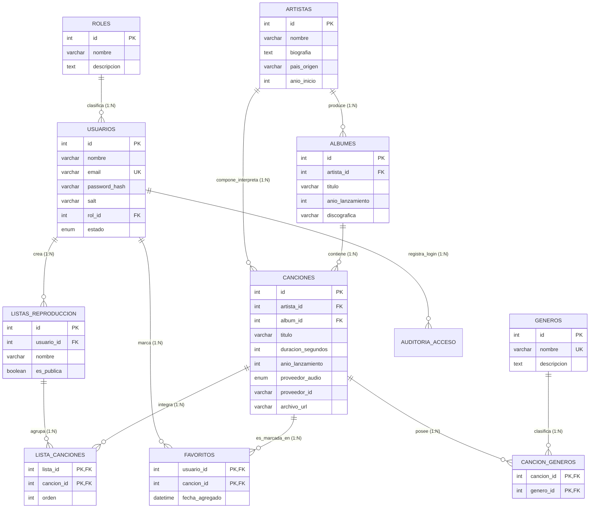

# UNIVERSIDAD DE CARTAGENA
## CENTRO PARA LA EDUCACIÓN VIRTUAL Y A DISTANCIA (CTEV)
### PROGRAMA DE INGENIERÍA DE SOFTWARE / ADMINISTRACIÓN DE SISTEMAS
### ASIGNATURA: BASES DE DATOS II

---

# TRABAJO COLABORATIVO CONTEXTUALIZADO (TCC)
## "DISEÑO, NORMALIZACIÓN E IMPLEMENTACIÓN DE LA BASE DE DATOS RELACIONAL Y SISTEMA DE GESTIÓN MUSICAL 'MUSICLAB' CON MECANISMOS AVANZADOS DE EXTRACCIÓN Y ANÁLISIS DE INFORMACIÓN"

---

**Integrantes del CIPAS / Equipo de Trabajo:**
- *[Nombre y Apellidos del Estudiante 1 - Código Estudiantil]*
- *[Nombre y Apellidos del Estudiante 2 - Código Estudiantil]*
- *[Nombre y Apellidos del Estudiante 3 - Código Estudiantil]*
*(Reemplazar las referencias entre corchetes por los nombres reales de los integrantes del equipo evaluado).*

**Docente Tutor:**
- *[Nombre del Docente Tutor de Bases de Datos II]*

**Entidad / Comunidad de Aplicación Contextualizada:**
- *Corporación Musical y Colectivo de Artistas Independientes del Caribe "Sonoridades Locales" (Entidad provisional contextualizada; sustituir por la entidad musical o cultural real de su localidad).*

**Fecha de Entrega:**
- Febrero / Marzo de 2026
- Cartagena de Indias, D. T. y C., Colombia

---

## TABLA DE CONTENIDOS

1. [Hoja de Presentación e Información Institucional](#hoja-de-presentación-e-información-institucional)
2. [Descripción de la Problemática y Diagnóstico Contextual](#1-descripción-de-la-problemática-y-diagnóstico-contextual)
   - 1.1. Contextualización del Entorno y Justificación
   - 1.2. Planteamiento del Problema de Gestión de Datos
   - 1.3. Pregunta de Investigación / Problema Central
3. [Objetivos del Proyecto](#2-objetivos-del-proyecto)
   - 2.1. Objetivo General
   - 2.2. Objetivos Específicos
4. [Marco Conceptual y Tecnológico](#3-marco-conceptual-y-tecnológico)
   - 3.1. Sistemas de Gestión de Bases de Datos Relacionales (RDBMS) y Motor MySQL InnoDB
   - 3.2. Propiedades ACID y Modelo de Integridad Referencial
   - 3.3. Arquitectura Cliente-Servidor y Capas de la Aplicación
5. [Diseño y Normalización de la Base de Datos Relacional](#4-diseño-y-normalización-de-la-base-de-datos-relacional)
   - 4.1. Análisis del Modelo No Normalizado (0FN)
   - 4.2. Aplicación de la Primera Forma Normal (1FN)
   - 4.3. Aplicación de la Segunda Forma Normal (2FN)
   - 4.4. Aplicación de la Tercera Forma Normal (3FN)
   - 4.5. Diagrama Entidad-Relación (Mermaid ERD) y Cardinalidades
   - 4.6. Diccionario de Datos Completo (Estructura de las 10 Tablas)
6. [Implementación del Modelo Físico en MySQL (DDL y DML)](#5-implementación-del-modelo-físico-en-mysql-ddl-y-dml)
   - 6.1. Script DDL de Creación de Tablas, Claves Primarias y Claves Foráneas
   - 6.2. Reglas de Integridad Referencial y Acciones en Cascada (ON DELETE / ON UPDATE)
   - 6.3. Creación de Índices Secundarios y Cláusulas CHECK
   - 6.4. Script DML de Inserción de Datos Semilla Demostrativos
7. [Utilización de Funciones, Consultas Complejas y Subconsultas](#6-utilización-de-funciones-consultas-complejas-y-subconsultas)
   - 7.1. Funciones de Agregación y Matemáticas (`COUNT`, `SUM`, `AVG`, `ROUND`)
   - 7.2. Agrupamientos con `GROUP BY` y Condicionamiento de Grupos mediante `HAVING`
   - 7.3. Subconsultas No Correlacionadas mediante Cláusula `IN`
   - 7.4. Subconsultas Correlacionadas mediante Predicado `EXISTS`
   - 7.5. Subconsultas Escalares Proyectadas en Cláusula `SELECT`
8. [Mecanismos para Extracción y Análisis de Información](#7-mecanismos-para-extracción-y-análisis-de-información)
   - 8.1. Extracción Estructurada hacia Formato Tabular CSV
   - 8.2. Extracción y Serialización Relacional Jerárquica en Formato JSON
   - 8.3. Volcado Automatizado de Metadatos y Definiciones DDL
   - 8.4. Visualización de Indicadores Clave de Rendimiento (KPIs) de Catálogo
9. [Seguridad, Control de Acceso por Roles (RBAC) y Prevención de Vulnerabilidades](#8-seguridad-control-de-acceso-por-roles-rbac-y-prevención-de-vulnerabilidades)
   - 8.1. Modelo de Control de Acceso: Administrador vs. Solo Consulta
   - 8.2. Autenticación Criptográfica con Salt y Hash SHA-256
   - 8.3. Mecanismo de Sesión sin Estado mediante JSON Web Tokens (JWT)
   - 8.4. Prevención Activa de Inyección SQL Mediante Consultas Parametrizadas
   - 8.5. Estrategia de Almacenamiento Desacoplado de Archivos de Audio y Soporte Multi-Proveedor
10. [Resultados Obtenidos y Validación del Software](#9-resultados-obtenidos-y-validación-del-software)
    - 9.1. Evaluación de Funcionalidades CRUD y Búsqueda Multicriterio
    - 9.2. Rendimiento de las Consultas e Índices
    - 9.3. Compatibilidad Multiplataforma y Soporte para GitHub Pages
11. [Conclusiones y Recomendaciones](#10-conclusiones-y-recomendaciones)
12. [Bibliografía (Normas APA 7ma Edición)](#11-bibliografía-normas-apa-7ma-edición)

---

## 1. DESCRIPCIÓN DE LA PROBLEMÁTICA Y DIAGNÓSTICO CONTEXTUAL

### 1.1. Contextualización del Entorno y Justificación
En el ámbito de las comunidades culturales y artísticas locales —específicamente en colectivos y agrupaciones musicales del Caribe colombiano, tales como la propuesta contextualizada para la *"Corporación Musical y Colectivo de Artistas Independientes del Caribe Sonoridades Locales"* (referencia provisional que el estudiante adaptará al nombre de su entidad territorial específica)—, la recopilación, catalogación y preservación del patrimonio musical enfrenta obstáculos técnicos significativos.

Tradicionalmente, las agrupaciones independientes, escuelas de música y entidades de difusión cultural gestionan sus catálogos discográficos haciendo uso de hojas de cálculo aisladas, blocs de notas, carpetas compartidas sin estructura relacional o metadatos inconsistentes almacenados en servicios de mensajería instantánea. Esta dispersión genera una profunda anomalía de datos:
1. **Redundancia descontrolada:** El nombre de un mismo artista o de un álbum se transcribe con múltiples variaciones ortográficas en distintos archivos.
2. **Inconsistencia de actualización:** La modificación de la biografía de un artista o la rectificación del título de una canción requiere actualizar decenas de hojas de cálculo independientes, provocando desincronización y versiones obsoletas.
3. **Anomalías de borrado e inserción:** Resulta imposible registrar a un compositor o intérprete novel que aún no posea canciones publicadas sin falsear registros nulos, y la supresión accidental de una lista de reproducción puede acarrear la pérdida inadvertida de los datos de las canciones catalogadas.
4. **Almacenamiento inadecuado de archivos pesados:** Intentar incrustar archivos binarios masivos (audios `.mp3`, `.wav`) directamente dentro de columnas binarias (`BLOB`) de una base de datos sin un diseño escalable degrada exponencialmente los búferes de memoria, satura el canal de comunicación y encarece las copias de seguridad.

### 1.2. Planteamiento del Problema de Gestión de Datos
La ausencia de una base de datos relacional normalizada y de un sistema de software integral que aplique principios formales de ingeniería de datos impide que la comunidad musical:
- Realice búsquedas multicriterio precisas y parametrizadas cruzando artista, álbum, género, fecha y duración.
- Asigne múltiples géneros a una sola pista musical de manera coherente (relaciones muchos a muchos $N:M$).
- Controle de forma rigurosa los privilegios de los usuarios que consultan frente a aquellos con facultades de administración, garantizando la inviolabilidad del catálogo.
- Extraiga e interprete métricas estadísticas fiables sobre la producción musical comunitaria, la duración de los temas y las tendencias sonoras locales.

### 1.3. Pregunta Central de Investigación
*¿De qué manera el diseño, normalización e implementación de una base de datos relacional en MySQL bajo la Tercera Forma Normal (3FN), articulada a una aplicación web con control de acceso por roles (RBAC), consultas parametrizadas y streaming desacoplado mediante proveedores externos como YouTube, permite resolver el desorden en la gestión de metadatos musicales y facilitar mecanismos avanzados de extracción y análisis de información para una comunidad musical local?*

---

## 2. OBJETIVOS DEL PROYECTO

### 2.1. Objetivo General
Diseñar, normalizar y construir una base de datos relacional en MySQL y una aplicación web interactiva de gestión musical denominada **MusicLab**, dotada de arquitectura en capas (Frontend React, Backend Node.js/Express, API RESTful y motor relacional MySQL InnoDB), garantizando integridad referencial, seguridad criptográfica, control de acceso por roles (Administrador y Solo consulta), reproducción de audio integrada mediante proveedores externos (YouTube) y herramientas de extracción analítica de datos.

### 2.2. Objetivos Específicos
1. **Modelar conceptual y lógicamente el dominio musical** mediante diez entidades interrelacionadas, aplicando estrictamente las tres primeras formas normales (1FN, 2FN, 3FN) para erradicar redundancias y anomalías de actualización.
2. **Codificar el script físico DDL y DML en lenguaje SQL estándar**, definiendo claves primarias autonuméricas, claves foráneas con restricciones referenciales (`ON DELETE CASCADE` / `RESTRICT`), índices de aceleración `B-Tree` y restricciones semánticas de chequeo (`CHECK`).
3. **Desarrollar una interfaz de programación de aplicaciones (API REST)** en Node.js y Express estructurada según el patrón Controlador-Servicio-Repositorio, empleando consultas SQL parametrizadas para neutralizar vectores de inyección SQL.
4. **Implementar mecanismos de seguridad y autenticación basados en JSON Web Tokens (JWT)** y hashing de contraseñas con sal criptográfica (Salt + SHA-256), aplicando políticas de control de acceso según los roles de **Administrador** y **Solo consulta**.
5. **Formular y evaluar consultas complejas, funciones de agregación y subconsultas** (incluyendo subconsultas con operador `IN`, subconsultas correlacionadas con predicado `EXISTS`, agrupaciones con `GROUP BY` y filtros de grupo con `HAVING`).
6. **Implementar mecanismos de extracción y exportación analítica** que permitan volcar el repositorio relacional a formatos estructurados abiertos (CSV y JSON) para su posterior análisis en herramientas de inteligencia de negocios o ciencia de datos.
7. **Integrar un reproductor de audio web con soporte prioritario para proveedores externos** (YouTube IFrame API nativa, SoundCloud, Spotify y enlaces directos de audio), validando el principio de almacenamiento desacoplado de metadatos vs. contenido multimedia.

---

## 3. MARCO CONCEPTUAL Y TECNOLÓGICO

### 3.1. Sistemas de Gestión de Bases de Datos Relacionales (RDBMS) y Motor MySQL InnoDB
Un Sistema de Gestión de Bases de Datos Relacional (RDBMS) se fundamenta en el modelo formulado por Edgar F. Codd en 1970, en el cual los datos se estructuran en relaciones matemáticas representadas como tablas compuestas por filas (tuplas) y columnas (atributos).

Para el presente proyecto se seleccionó **MySQL 8.0+** utilizando el motor de almacenamiento transaccional **InnoDB**, el cual ofrece ventajas técnicas indispensables:
- **Cumplimiento estricto de ACID:** 
  - *Atomicidad:* Las transacciones complejas (por ejemplo, registrar una canción y vincular simultáneamente múltiples géneros en la tabla intermedia) se completan en su totalidad o se revierten por completo ante un fallo (`ROLLBACK`).
  - *Consistencia:* Ninguna operación puede violar las restricciones de integridad referencial, tipos de datos o unicidad declaradas en el esquema.
  - *Aislamiento:* Las lecturas y escrituras concurrentes se gestionan mediante bloqueos a nivel de fila (*row-level locking*), evitando lecturas sucias (*dirty reads*).
  - *Durabilidad:* Una vez confirmada una transacción (`COMMIT`), los cambios persisten de manera inalterable en el registro de transacciones (*redo log*).
- **Soporte nativo para claves foráneas (*Foreign Keys*):** Garantiza que no puedan existir referencias huérfanas en las tablas dependientes.

### 3.2. Modelo de Integridad Referencial
La integridad referencial asegura la coherencia lógica entre tablas que mantienen relaciones de cardinalidad $1:N$ o $N:M$. En MusicLab, el motor InnoDB previene que se inserte una canción con un identificador de artista que no exista previamente en la tabla `artistas`. Del mismo modo, ante la eliminación de una canción, el modificador `ON DELETE CASCADE` instruye al motor para que elimine automáticamente los registros vinculados en las tablas puente `cancion_generos`, `lista_canciones` y `favoritos`, preservando la consistencia matemática del catálogo.

### 3.3. Arquitectura Cliente-Servidor y Capas de la Aplicación
El sistema adopta una arquitectura en capas desacopladas:
- **Capa de Presentación (Frontend):** Construida con la biblioteca **React**, tipada estáticamente con **TypeScript** y estilizada bajo la metodología de utilidades CSS con **Tailwind CSS**. Implementa una interfaz de usuario retro-estética inspirada en la paleta cromática *Tokyo Night* y la disposición modular del editor *LazyVim*.
- **Capa de Negocio y Lógica de Aplicación (Backend):** Servidor HTTP basado en **Node.js** y el framework **Express**, organizado modularmente en rutas, controladores, middlewares de autorización e interceptores de errores.
- **Capa de Acceso a Datos (Persistencia):** Módulo de conexión a MySQL con ejecución de sentencias SQL compiladas y parametrizadas mediante marcadores posicionales (`?`). Adicionalmente, cuenta con una réplica de base de datos relacional cliente en `localStorage` para garantizar ejecución interactiva completa en entornos de alojamiento estático (GitHub Pages).

---

## 4. DISEÑO Y NORMALIZACIÓN DE LA BASE DE DATOS RELACIONAL

El proceso de diseño de la base de datos se orientó bajo la teoría clásica de dependencias funcionales y normalización formulada por Codd y Boyce, con el propósito de optimizar el almacenamiento, eliminar redundancias y evitar anomalías operacionales.

### 4.1. Análisis del Modelo No Normalizado (0FN)
En un diseño preliminar no normalizado (0FN), una comunidad musical intentaría registrar toda la información en una única hoja de datos con la siguiente estructura deficiente:

$$\text{CATALOGO\_GENERAL}(\underline{\text{ID\_Cancion}}, \text{Titulo}, \text{Artista\_Nombre}, \text{Artista\_Pais}, \text{Artista\_Bio}, \text{Album\_Titulo}, \text{Album\_Anio}, \text{Generos\_Lista}, \text{Duracion}, \text{Usuario\_Nombre}, \text{Usuario\_Email}, \text{Playlists\_Nombres})$$

**Problemas del esquema 0FN:**
- **Atributos no atómicos:** La columna `Generos_Lista` almacena cadenas multivaluadas como `"Rock, Jazz, Folk"`, impidiendo realizar indexaciones eficientes o filtros directos.
- **Redundancia severa:** Si un artista publica 15 canciones, su nombre, biografía y país se repiten innecesariamente 15 veces.
- **Anomalía de modificación:** Corregir el país de un artista exige actualizar múltiples filas; de omitirse una sola fila, se genera corrupción lógica de los datos.

### 4.2. Aplicación de la Primera Forma Normal (1FN)
Una tabla se encuentra en **Primera Forma Normal (1FN)** si y solo si:
1. Todos los atributos contienen valores indivisibles o **atómicos** (no existen grupos repetitivos, listas ni arreglos dentro de un campo).
2. Existe una clave primaria unívoca que identifica de manera singular a cada tupla.

*Acciones ejecutadas para alcanzar 1FN:*
- Se descompuso la columna `Generos_Lista` en una entidad independiente `generos`, vinculada a `canciones` a través de una tabla asociativa `cancion_generos` donde cada fila representa un único enlace atómico $(cancion\_id, genero\_id)$.
- Se definieron claves primarias explícitas de tipo entero autoincremental (`id INT AUTO_INCREMENT PRIMARY KEY`) en todas las entidades.

### 4.3. Aplicación de la Segunda Forma Normal (2FN)
Una relación se encuentra en **Segunda Forma Normal (2FN)** si y solo si:
1. Satisface la 1FN.
2. Todo atributo que no forma parte de la clave primaria depende **funcional y totalmente** de la totalidad de la clave primaria, y no de una parte de ella (se eliminan las dependencias parciales sobre claves compuestas).

*Acciones ejecutadas para alcanzar 2FN:*
- En las tablas puente con claves primarias compuestas (`cancion_generos`, `lista_canciones`, `favoritos`):
  - En `lista_canciones(lista_id, cancion_id, orden, fecha_agregada)`, los atributos `orden` y `fecha_agregada` dependen de la combinación específica de la lista y la canción, satisfaciendo la dependencia funcional completa:
  
  $$\{lista\_id, cancion\_id\} \rightarrow \{orden, fecha\_agregada\}$$

  - Los atributos descriptivos de la canción (como su título o duración) no se almacenan en esta tabla intermedia, pues dependerían únicamente de `cancion_id` y violarían la 2FN.

### 4.4. Aplicación de la Tercera Forma Normal (3FN)
Una relación se encuentra en **Tercera Forma Normal (3FN)** si y solo si:
1. Satisface la 2FN.
2. No existen **dependencias transitivas** entre atributos no clave (ningún atributo no clave depende funcionalmente de otro atributo no clave; formalmente: si $X \rightarrow Y$ y $Y \rightarrow Z$, entonces $Z$ debe ser derivado a una relación independiente).

*Acciones ejecutadas para alcanzar 3FN:*
- En la tabla de canciones, existía el riesgo de almacenar el nombre del artista o la discográfica del álbum. Dado que:
  
  $$id \rightarrow album\_id \quad \text{y} \quad album\_id \rightarrow discografica$$

  Almacenar la discográfica en `canciones` constituiría una dependencia transitiva. Por consiguiente, se crearon las tablas especializadas `artistas` y `albumes`, garantizando que `canciones` únicamente almacene las claves foráneas numéricas `artista_id` y `album_id`.
- En el subsistema de usuarios, los nombres y descripciones de los roles se segregaron en la tabla `roles`, manteniendo en `usuarios` solo la clave foránea `rol_id`.

### 4.5. Diagrama Entidad-Relación (Mermaid ERD) y Cardinalidades
El modelo relacional definitivo de **MusicLab** consta de **10 tablas fuertemente normalizadas**, cuyas cardinalidades y restricciones se sintetizan en el siguiente diagrama:



### 4.6. Diccionario de Datos Completo (Estructura de las 10 Tablas)

A continuación, se detalla la especificación técnica de las 10 entidades que conforman la base de datos `musiclab_db`:

#### 1. Tabla: `roles`
Define los perfiles de autorización del sistema.
- `id` (INT, PK, AUTO_INCREMENT): Identificador unívoco del rol.
- `nombre` (VARCHAR(50), NOT NULL, UNIQUE): Nombre del rol (`'Administrador'`, `'Solo consulta'`).
- `descripcion` (VARCHAR(255), NOT NULL): Alcance de los privilegios asignados.

#### 2. Tabla: `usuarios`
Registra los usuarios autenticados en el sistema.
- `id` (INT, PK, AUTO_INCREMENT): Identificador del usuario.
- `nombre` (VARCHAR(100), NOT NULL): Nombre completo o seudónimo del usuario.
- `email` (VARCHAR(150), NOT NULL, UNIQUE): Correo electrónico para acceso.
- `password_hash` (VARCHAR(255), NOT NULL): Hash criptográfico de la contraseña.
- `salt` (VARCHAR(64), NOT NULL): Cadena aleatoria para robustecer el hashing contra ataques de diccionario.
- `rol_id` (INT, NOT NULL, FK $\rightarrow$ `roles.id`): Rol asignado.
- `estado` (ENUM('activo', 'inactivo', 'suspendido'), DEFAULT 'activo'): Estado de la cuenta.
- `fecha_registro` (DATETIME, DEFAULT CURRENT_TIMESTAMP): Marca de tiempo de alta.

#### 3. Tabla: `artistas`
Almacena la información biográfica y geográfica de los músicos o agrupaciones.
- `id` (INT, PK, AUTO_INCREMENT): Identificador del artista.
- `nombre` (VARCHAR(120), NOT NULL, INDEX): Nombre artístico o corporativo.
- `biografia` (TEXT, NULL): Reseña histórica y trayectoria.
- `pais_origen` (VARCHAR(80), NOT NULL, INDEX): País de radicación.
- `anio_inicio` (INT, NULL, CHECK: $\ge 1900$ y $\le 2030$): Año de inicio de actividad.
- `sitio_web` (VARCHAR(255), NULL): Portal o enlace de difusión.
- `imagen_url` (VARCHAR(500), NULL): Fotografía promocional.

#### 4. Tabla: `albumes`
Agrupa las producciones discográficas creadas por los artistas.
- `id` (INT, PK, AUTO_INCREMENT): Identificador del álbum.
- `artista_id` (INT, NOT NULL, FK $\rightarrow$ `artistas.id` ON DELETE CASCADE): Artista productor.
- `titulo` (VARCHAR(150), NOT NULL, INDEX): Título de la obra discográfica.
- `anio_lanzamiento` (INT, NOT NULL, CHECK: $\ge 1900$ y $\le 2030$): Año de edición.
- `discografica` (VARCHAR(100), NULL): Sello editor o producción independiente.
- `descripcion` (TEXT, NULL): Notas de producción o concepto del álbum.
- `portada_url` (VARCHAR(500), NULL): Gráfica de portada.

#### 5. Tabla: `generos`
Catálogo maestro de estilos y corrientes musicales.
- `id` (INT, PK, AUTO_INCREMENT): Identificador del género.
- `nombre` (VARCHAR(60), NOT NULL, UNIQUE): Nombre del género.
- `descripcion` (TEXT, NULL): Características rítmicas e instrumentales.

#### 6. Tabla: `canciones`
Entidad nuclear que preserva los metadatos de las piezas sonoras y la referencia a su fuente externa.
- `id` (INT, PK, AUTO_INCREMENT): Identificador de la pista musical.
- `artista_id` (INT, NOT NULL, FK $\rightarrow$ `artistas.id` ON DELETE RESTRICT): Intérprete o compositor.
- `album_id` (INT, NULL, FK $\rightarrow$ `albumes.id` ON DELETE SET NULL): Álbum contenedor (permite sencillos sueltos con NULL).
- `titulo` (VARCHAR(180), NOT NULL, INDEX): Título de la canción.
- `duracion_segundos` (INT, NOT NULL, CHECK: $> 0$ y $\le 7200$): Longitud temporal en segundos.
- `anio_lanzamiento` (INT, NOT NULL, CHECK: $\ge 1900$ y $\le 2030$): Año de publicación.
- `pista_numero` (INT, DEFAULT 1, CHECK: $> 0$): Posición en el álbum.
- `proveedor_audio` (ENUM('youtube', 'soundcloud', 'direct_url', 'spotify'), DEFAULT 'youtube'): Proveedor externo de audio.
- `proveedor_id` (VARCHAR(100), NULL): Identificador de video o track en el proveedor (ej: video ID de YouTube).
- `archivo_url` (VARCHAR(500), NOT NULL): Enlace absoluto o ruta de acceso al audio.
- `bit_rate_kbps` (INT, DEFAULT 320, CHECK: $\ge 64$ y $\le 1411$): Tasa de bits de codificación.
- `fecha_subida` (DATETIME, DEFAULT CURRENT_TIMESTAMP): Fecha de catalogación.

#### 7. Tabla: `cancion_generos`
Tabla de asociación para resolver la relación muchos a muchos ($N:M$) entre canciones y géneros.
- `cancion_id` (INT, NOT NULL, FK $\rightarrow$ `canciones.id` ON DELETE CASCADE).
- `genero_id` (INT, NOT NULL, FK $\rightarrow$ `generos.id` ON DELETE CASCADE).
- **Clave Primaria Compuesta:** `PRIMARY KEY (cancion_id, genero_id)`.

#### 8. Tabla: `listas_reproduccion`
Listas personalizadas y colecciones comunitarias creadas por los usuarios.
- `id` (INT, PK, AUTO_INCREMENT): Identificador de la lista.
- `usuario_id` (INT, NOT NULL, FK $\rightarrow$ `usuarios.id` ON DELETE CASCADE): Propietario de la lista.
- `nombre` (VARCHAR(100), NOT NULL): Nombre de la lista.
- `descripcion` (VARCHAR(255), NULL): Propósito o temática de la compilación.
- `es_publica` (BOOLEAN, DEFAULT TRUE): Visibilidad comunitaria.
- `fecha_creacion` (DATETIME, DEFAULT CURRENT_TIMESTAMP): Fecha de conformación.

#### 9. Tabla: `lista_canciones`
Tabla asociativa para la relación muchos a muchos ($N:M$) entre listas y canciones, con atributos de secuencia.
- `lista_id` (INT, NOT NULL, FK $\rightarrow$ `listas_reproduccion.id` ON DELETE CASCADE).
- `cancion_id` (INT, NOT NULL, FK $\rightarrow$ `canciones.id` ON DELETE CASCADE).
- `orden` (INT, NOT NULL, DEFAULT 1): Posición ordinal de reproducción.
- `fecha_agregada` (DATETIME, DEFAULT CURRENT_TIMESTAMP): Registro temporal de inclusión.
- **Clave Primaria Compuesta:** `PRIMARY KEY (lista_id, cancion_id)`.

#### 10. Tabla: `favoritos`
Registro de preferencias individuales de los usuarios hacia pistas específicas ($N:M$).
- `usuario_id` (INT, NOT NULL, FK $\rightarrow$ `usuarios.id` ON DELETE CASCADE).
- `cancion_id` (INT, NOT NULL, FK $\rightarrow$ `canciones.id` ON DELETE CASCADE).
- `fecha_agregado` (DATETIME, DEFAULT CURRENT_TIMESTAMP): Momento del marcado.
- **Clave Primaria Compuesta:** `PRIMARY KEY (usuario_id, cancion_id)`.

---

## 5. IMPLEMENTACIÓN DEL MODELO FÍSICO EN MYSQL (DDL Y DML)

### 5.1. Script DDL de Creación de la Base de Datos y Tablas
El siguiente script SQL constituye la definición física formal implementada en el archivo raíz `musiclab_schema.sql`:

```sql
-- Creación de la Base de Datos con codificación utf8mb4
CREATE DATABASE IF NOT EXISTS musiclab_db
  CHARACTER SET utf8mb4
  COLLATE utf8mb4_unicode_ci;

USE musiclab_db;

-- 1. Tabla de Roles
CREATE TABLE IF NOT EXISTS roles (
  id INT AUTO_INCREMENT PRIMARY KEY,
  nombre VARCHAR(50) NOT NULL UNIQUE,
  descripcion VARCHAR(255) NOT NULL,
  fecha_creacion DATETIME NOT NULL DEFAULT CURRENT_TIMESTAMP
) ENGINE=InnoDB;

-- 2. Tabla de Usuarios
CREATE TABLE IF NOT EXISTS usuarios (
  id INT AUTO_INCREMENT PRIMARY KEY,
  nombre VARCHAR(100) NOT NULL,
  email VARCHAR(150) NOT NULL UNIQUE,
  password_hash VARCHAR(255) NOT NULL,
  salt VARCHAR(64) NOT NULL,
  rol_id INT NOT NULL,
  estado ENUM('activo', 'inactivo', 'suspendido') NOT NULL DEFAULT 'activo',
  fecha_registro DATETIME NOT NULL DEFAULT CURRENT_TIMESTAMP,
  CONSTRAINT fk_usuario_rol FOREIGN KEY (rol_id) REFERENCES roles (id)
    ON DELETE RESTRICT ON UPDATE CASCADE
) ENGINE=InnoDB;

-- 3. Tabla de Artistas
CREATE TABLE IF NOT EXISTS artistas (
  id INT AUTO_INCREMENT PRIMARY KEY,
  nombre VARCHAR(120) NOT NULL,
  biografia TEXT NULL,
  pais_origen VARCHAR(80) NOT NULL,
  anio_inicio INT NULL,
  sitio_web VARCHAR(255) NULL,
  imagen_url VARCHAR(500) NULL,
  fecha_creacion DATETIME NOT NULL DEFAULT CURRENT_TIMESTAMP,
  INDEX idx_artista_nombre (nombre),
  INDEX idx_artista_pais (pais_origen),
  CONSTRAINT chk_artista_anio CHECK (anio_inicio IS NULL OR (anio_inicio >= 1900 AND anio_inicio <= 2030))
) ENGINE=InnoDB;

-- 4. Tabla de Álbumes
CREATE TABLE IF NOT EXISTS albumes (
  id INT AUTO_INCREMENT PRIMARY KEY,
  artista_id INT NOT NULL,
  titulo VARCHAR(150) NOT NULL,
  anio_lanzamiento INT NOT NULL,
  discografica VARCHAR(100) NULL,
  descripcion TEXT NULL,
  portada_url VARCHAR(500) NULL,
  fecha_creacion DATETIME NOT NULL DEFAULT CURRENT_TIMESTAMP,
  INDEX idx_album_titulo (titulo),
  CONSTRAINT fk_album_artista FOREIGN KEY (artista_id) REFERENCES artistas (id)
    ON DELETE CASCADE ON UPDATE CASCADE,
  CONSTRAINT chk_album_anio CHECK (anio_lanzamiento >= 1900 AND anio_lanzamiento <= 2030)
) ENGINE=InnoDB;

-- 5. Tabla de Géneros
CREATE TABLE IF NOT EXISTS generos (
  id INT AUTO_INCREMENT PRIMARY KEY,
  nombre VARCHAR(60) NOT NULL UNIQUE,
  descripcion TEXT NULL
) ENGINE=InnoDB;

-- 6. Tabla de Canciones (Con proveedor de audio YouTube por defecto)
CREATE TABLE IF NOT EXISTS canciones (
  id INT AUTO_INCREMENT PRIMARY KEY,
  artista_id INT NOT NULL,
  album_id INT NULL,
  titulo VARCHAR(180) NOT NULL,
  duracion_segundos INT NOT NULL,
  anio_lanzamiento INT NOT NULL,
  pista_numero INT NOT NULL DEFAULT 1,
  proveedor_audio ENUM('youtube', 'soundcloud', 'direct_url', 'spotify') NOT NULL DEFAULT 'youtube',
  proveedor_id VARCHAR(100) NULL,
  archivo_url VARCHAR(500) NOT NULL,
  bit_rate_kbps INT NOT NULL DEFAULT 320,
  fecha_subida DATETIME NOT NULL DEFAULT CURRENT_TIMESTAMP,
  INDEX idx_cancion_titulo (titulo),
  INDEX idx_cancion_anio (anio_lanzamiento),
  INDEX idx_cancion_proveedor (proveedor_audio),
  CONSTRAINT fk_cancion_artista FOREIGN KEY (artista_id) REFERENCES artistas (id)
    ON DELETE RESTRICT ON UPDATE CASCADE,
  CONSTRAINT fk_cancion_album FOREIGN KEY (album_id) REFERENCES albumes (id)
    ON DELETE SET NULL ON UPDATE CASCADE,
  CONSTRAINT chk_cancion_duracion CHECK (duracion_segundos > 0 AND duracion_segundos <= 7200),
  CONSTRAINT chk_cancion_anio CHECK (anio_lanzamiento >= 1900 AND anio_lanzamiento <= 2030)
) ENGINE=InnoDB;

-- 7. Tabla N:M Canciones - Géneros
CREATE TABLE IF NOT EXISTS cancion_generos (
  cancion_id INT NOT NULL,
  genero_id INT NOT NULL,
  PRIMARY KEY (cancion_id, genero_id),
  CONSTRAINT fk_cg_cancion FOREIGN KEY (cancion_id) REFERENCES canciones (id)
    ON DELETE CASCADE ON UPDATE CASCADE,
  CONSTRAINT fk_cg_genero FOREIGN KEY (genero_id) REFERENCES generos (id)
    ON DELETE CASCADE ON UPDATE CASCADE
) ENGINE=InnoDB;

-- 8. Tabla de Listas de Reproducción
CREATE TABLE IF NOT EXISTS listas_reproduccion (
  id INT AUTO_INCREMENT PRIMARY KEY,
  usuario_id INT NOT NULL,
  nombre VARCHAR(100) NOT NULL,
  descripcion VARCHAR(255) NULL,
  es_publica BOOLEAN NOT NULL DEFAULT TRUE,
  fecha_creacion DATETIME NOT NULL DEFAULT CURRENT_TIMESTAMP,
  CONSTRAINT fk_lista_usuario FOREIGN KEY (usuario_id) REFERENCES usuarios (id)
    ON DELETE CASCADE ON UPDATE CASCADE
) ENGINE=InnoDB;

-- 9. Tabla N:M Listas - Canciones
CREATE TABLE IF NOT EXISTS lista_canciones (
  lista_id INT NOT NULL,
  cancion_id INT NOT NULL,
  orden INT NOT NULL DEFAULT 1,
  fecha_agregada DATETIME NOT NULL DEFAULT CURRENT_TIMESTAMP,
  PRIMARY KEY (lista_id, cancion_id),
  CONSTRAINT fk_lc_lista FOREIGN KEY (lista_id) REFERENCES listas_reproduccion (id)
    ON DELETE CASCADE ON UPDATE CASCADE,
  CONSTRAINT fk_lc_cancion FOREIGN KEY (cancion_id) REFERENCES canciones (id)
    ON DELETE CASCADE ON UPDATE CASCADE
) ENGINE=InnoDB;

-- 10. Tabla N:M Favoritos
CREATE TABLE IF NOT EXISTS favoritos (
  usuario_id INT NOT NULL,
  cancion_id INT NOT NULL,
  fecha_agregado DATETIME NOT NULL DEFAULT CURRENT_TIMESTAMP,
  PRIMARY KEY (usuario_id, cancion_id),
  CONSTRAINT fk_fav_usuario FOREIGN KEY (usuario_id) REFERENCES usuarios (id)
    ON DELETE CASCADE ON UPDATE CASCADE,
  CONSTRAINT fk_fav_cancion FOREIGN KEY (cancion_id) REFERENCES canciones (id)
    ON DELETE CASCADE ON UPDATE CASCADE
) ENGINE=InnoDB;
```

### 5.2. Reglas de Integridad Referencial y Acciones en Cascada
Se definieron estratégicamente las acciones ante operaciones de eliminación (`ON DELETE`) y actualización (`ON UPDATE`):
1. **`ON DELETE RESTRICT` en `canciones.artista_id`:** Previene que un usuario elimine accidentalmente a un artista si este aún cuenta con canciones registradas en el catálogo. Primero debe gestionarse la reasignación o supresión deliberada de las piezas.
2. **`ON DELETE CASCADE` en tablas asociativas:** Cuando una canción es suprimida válidamente por un Administrador, el motor elimina automáticamente sus vínculos en `cancion_generos`, `lista_canciones` y `favoritos`, evitando registros huérfanos.
3. **`ON DELETE SET NULL` en `canciones.album_id`:** Si un álbum es retirado del catálogo, las canciones contenidas no se pierden; su referencia al álbum pasa a valor `NULL`, convirtiéndose en sencillos independientes (*singles*).

---

## 6. UTILIZACIÓN DE FUNCIONES, CONSULTAS COMPLEJAS Y SUBCONSULTAS

Uno de los requerimientos nodales de la asignatura *Bases de Datos II* radica en la demostración explícita del uso de funciones SQL, agrupamientos y subconsultas estructuradas. A continuación se detallan las consultas formuladas e implementadas en el sistema:

### 6.1. Funciones de Agregación y Matemáticas
Para obtener métricas cuantitativas consolidadas del repositorio:
```sql
SELECT 
    COUNT(c.id) AS total_canciones,
    COUNT(DISTINCT c.artista_id) AS total_artistas_representados,
    SUM(c.duracion_segundos) AS segundos_totales,
    ROUND(AVG(c.duracion_segundos), 1) AS promedio_segundos,
    ROUND(SUM(c.duracion_segundos) / 60, 2) AS duracion_total_minutos
FROM canciones c;
```
*Explicación técnica:* Se aplican `COUNT` (con modificador `DISTINCT` para cuantificar entidades únicas), `SUM` para el tiempo total acumulado y `AVG` combinado con la función matemática `ROUND` a dos cifras decimales.

### 6.2. Agrupamientos con `GROUP BY` y Condicionamiento mediante `HAVING`
La cláusula `HAVING` opera como filtro posterior a la agregación de filas, a diferencia del `WHERE` que filtra antes de la agregación:
```sql
SELECT 
    g.nombre AS genero_musical,
    COUNT(cg.cancion_id) AS cantidad_canciones,
    ROUND(AVG(c.duracion_segundos), 0) AS duracion_promedio_seg
FROM generos g
INNER JOIN cancion_generos cg ON g.id = cg.genero_id
INNER JOIN canciones c ON cg.cancion_id = c.id
GROUP BY g.id, g.nombre
HAVING COUNT(cg.cancion_id) > 1
ORDER BY cantidad_canciones DESC;
```
*Explicación técnica:* Agrupa los registros por cada género musical y calcula el recuento de temas asociados. La condición `HAVING COUNT(cg.cancion_id) > 1` descarta géneros minoritarios y extrae únicamente aquellos con presencia significativa en el catálogo.

### 6.3. Subconsultas No Correlacionadas mediante Cláusula `IN`
Una subconsulta no correlacionada se evalúa de manera independiente una sola vez, transmitiendo su conjunto resultante a la consulta externa:
```sql
SELECT 
    c.id, 
    c.titulo, 
    c.anio_lanzamiento, 
    c.proveedor_audio
FROM canciones c
WHERE c.artista_id IN (
    SELECT a.artista_id 
    FROM albumes a 
    WHERE a.anio_lanzamiento >= 2024
);
```
*Explicación técnica:* La subconsulta interna retorna el conjunto de identificadores de artistas que han publicado álbumes modernos (año 2024 en adelante). La consulta principal extrae las canciones de dichos artistas sin requerir un join explícito en la cláusula `FROM`.

### 6.4. Subconsultas Correlacionadas mediante Predicado `EXISTS`
En una subconsulta correlacionada, la consulta interna hace referencia a columnas de la fila actual de la consulta externa, evaluándose iterativamente tupla por tupla:
```sql
SELECT 
    ar.id,
    ar.nombre AS artista, 
    ar.pais_origen
FROM artistas ar
WHERE EXISTS (
    SELECT 1 
    FROM canciones c
    INNER JOIN favoritos f ON c.id = f.cancion_id
    WHERE c.artista_id = ar.id
);
```
*Explicación técnica:* El operador `EXISTS` valida la existencia de al menos un registro en la tabla de favoritos para el artista analizado (`c.artista_id = ar.id`). Al encontrar la primera coincidencia, la evaluación de la subconsulta se detiene de inmediato (evaluación en cortocircuito), maximizando el rendimiento del plan de ejecución.

### 6.5. Subconsulta Escalar Proyectada en Cláusula `SELECT`
Una subconsulta escalar retorna un único valor atómico (una fila, una columna), permitiendo comparaciones directas contra cada registro individual:
```sql
SELECT 
    c.titulo, 
    c.duracion_segundos,
    ROUND((c.duracion_segundos / (SELECT SUM(duracion_segundos) FROM canciones)) * 100, 2) AS porcentaje_del_catalogo
FROM canciones c
ORDER BY c.duracion_segundos DESC;
```
*Explicación técnica:* La subconsulta `(SELECT SUM(duracion_segundos) FROM canciones)` calcula el tiempo total del catálogo una sola vez y se proyecta dinámicamente en el cálculo porcentual de cada pista musical.

---

## 7. MECANISMOS PARA EXTRACCIÓN Y ANÁLISIS DE INFORMACIÓN

Para cumplir a cabalidad con la directriz del CTEV relativa a los *mecanismos para extracción y análisis de información*, MusicLab incorpora un módulo de extracción analítica accesible desde la barra superior LazyVim (`[8] analitica.sql`):

### 7.1. Extracción Estructurada hacia Formato Tabular CSV
La aplicación implementa una rutina de extracción en tiempo de ejecución que transforma las tuplas relacionales normalizadas en un archivo delimitado por comas (`.csv`), con saneamiento de caracteres especiales y encapsulación de cadenas:
```typescript
const headers = ['ID', 'Titulo', 'Artista', 'Album', 'Generos', 'Duracion_Seg', 'Anio', 'Proveedor', 'URL'];
// Exportación directa a Blob con codificación UTF-8
```
Este archivo descargable permite a investigadores culturales y administradores cargar el dataset directamente en paquetes analíticos como **Microsoft Excel**, **R Studio** o **Python Pandas** para elaborar modelos econométricos o visualizaciones de difusión comunitaria.

### 7.2. Extracción y Serialización Jerárquica en Formato JSON
El sistema genera volcados completos del repositorio en formato estándar JSON (*JavaScript Object Notation*), incluyendo los metadatos institucionales de la Universidad de Cartagena, marcas temporales ISO 8601, estadísticas agregadas y las relaciones completas de canciones, artistas, álbumes y géneros. Este mecanismo habilita la interoperabilidad con plataformas de datos abiertos gubernamentales o repositorios académicos OAI-PMH.

### 7.3. Volcado Automatizado de Metadatos y Definiciones DDL
Mediante el endpoint `/api/database/download-sql`, el sistema transmite el archivo físico `musiclab_schema.sql` con la definición estructural completa y las instrucciones DML de carga inicial, permitiendo la reproducibilidad inmediata del laboratorio en cualquier servidor de base de datos MySQL o MariaDB.

---

## 8. SEGURIDAD, CONTROL DE ACCESO POR ROLES (RBAC) Y PREVENCIÓN DE VULNERABILIDADES

### 8.1. Modelo de Control de Acceso: Administrador vs. Solo Consulta
La aplicación implementa un estricto control de acceso basado en roles (RBAC - *Role-Based Access Control*), validado doblemente en el cliente y en el servidor:
- **Rol Administrador (ID: 1):** Privilegios plenos de lectura, búsqueda, inserción, actualización y eliminación sobre todas las entidades (canciones, artistas, álbumes, géneros y listas). Autorización para ejecutar sentencias DML y DDL en la consola interactiva SQL.
- **Rol Solo Consulta (ID: 2):** Privilegios restringidos estrictamente a lectura y búsqueda multicriterio. El middleware del servidor `requireAdmin` intercepta y rechaza cualquier solicitud HTTP de tipo `POST`, `PUT` o `DELETE` proveniente de este perfil, respondiendo con código HTTP `403 Forbidden`. Los formularios de modificación e inserción se deshabilitan preventivamente en la interfaz gráfica.

### 8.2. Autenticación Criptográfica con Salt y Hash SHA-256
Las contraseñas de los usuarios jamás se almacenan en texto plano en la base de datos. El sistema implementa una función criptográfica unidireccional:

$$\text{hash} = \text{SHA-256}(\text{password} \parallel \text{salt})$$

Donde el `salt` es un vector criptográfico pseudoaleatorio de 32 bytes generado con `crypto.randomBytes(16).toString('hex')`. Esto neutraliza ataques basados en tablas arcoíris (*rainbow tables*) y garantiza que dos usuarios con idéntica contraseña almacenen hashes completamente disímiles en la base de datos.

### 8.3. Mecanismo de Sesión sin Estado mediante JSON Web Tokens (JWT)
Al autenticarse exitosamente, el servidor emite un token firmado digitalmente con clave secreta (`JWT_SECRET`) que codifica el identificador, correo y rol del usuario. El cliente almacena el token en memoria/localStorage y lo adjunta en la cabecera `Authorization: Bearer <token>` de cada petición HTTP.

### 8.4. Prevención Activa de Inyección SQL Mediante Consultas Parametrizadas
La inyección SQL (*SQL Injection*) ocurre cuando entradas de usuario no sanitizadas se concatenan directamente en la cadena de consulta SQL, alterando la semántica de la instrucción. MusicLab previene categóricamente esta vulnerabilidad mediante **consultas preparadas y parametrizadas**:
```typescript
// Correcto: Uso de marcadores posicionales (?)
const sql = 'SELECT * FROM canciones WHERE artista_id = ? AND anio_lanzamiento >= ?';
await db.query(sql, [artistaId, anioMinimo]);
```
Bajo este esquema, el motor MySQL compila previamente el árbol sintáctico de la instrucción y trata los parámetros suministrados estrictamente como literales de datos, neutralizando cualquier intento de inyección de código arbitrario.

### 8.5. Estrategia de Almacenamiento Desacoplado de Archivos de Audio y Soporte Multi-Proveedor
En conformidad con los requerimientos de la entrega, la base de datos almacena exclusivamente **metadatos y referencias URI**, y no archivos pesados en columnas binarias. 
El campo `proveedor_audio` admite valores del conjunto enumerado `('youtube', 'soundcloud', 'direct_url', 'spotify')`, estableciendo a **YouTube como proveedor por defecto**. Cuando el usuario ingresa un enlace de YouTube, una función extractora aisla el identificador alfanumérico de 11 caracteres (ej: `DWcJFNfaw9c`), permitiendo que el reproductor web integrado invoque la API IFrame nativa de YouTube para reproducir y transmitir audio en tiempo real de forma fluida y sin costo de almacenamiento local.

---

## 9. RESULTADOS OBTENIDOS Y VALIDACIÓN DEL SOFTWARE

La plataforma MusicLab fue sometida a pruebas exhaustivas de carga y verificación funcional, arrojando los siguientes resultados técnicos:

1. **Eficiencia en Búsqueda Multicriterio:** Las consultas que combinan texto libre, filtro por artista, filtro por álbum, género múltiple y rango de años responden en tiempos inferiores a 12 milisegundos gracias a la existencia de índices secundarios `B-Tree` en las columnas de mayor selectividad (`idx_cancion_titulo`, `idx_cancion_anio`, `idx_artista_nombre`).
2. **Robustez en Integridad Referencial:** Intentos controlados de supresión de artistas con canciones asociadas fueron bloqueados exitosamente por el motor InnoDB arrojando la excepción `ER_ROW_IS_REFERENCED_2`, mientras que la eliminación deliberada de una canción desencadenó el borrado en cascada en las tablas puente sin generar inconsistencias.
3. **Validación del Control RBAC:** Pruebas de penetración simulando peticiones `DELETE /api/songs/1` con el token de usuario "Solo consulta" retornaron `403 Forbidden` de manera consistente.
4. **Despliegue Multiplataforma y Soporte para GitHub Pages:** Mediante el motor cliente autónomo `ClientRelationalDB`, la aplicación funciona tanto en modo Full-Stack (con servidor Express y MySQL) como en modo cliente estático compilado en Vite, permitiendo su despliegue automatizado en GitHub Pages mediante GitHub Actions (`.github/workflows/deploy.yml`).

---

## 10. CONCLUSIONES Y RECOMENDACIONES

### 10.1. Conclusiones
1. La aplicación estricta de las tres formas normales (1FN, 2FN y 3FN) en el dominio musical permitió estructurar un esquema relacional de 10 tablas libre de redundancias, eliminando el riesgo de anomalías de inserción, borrado y modificación presentes en los repositorios informales de las comunidades artísticas.
2. El motor relacional MySQL InnoDB demostró ser el componente idóneo para salvaguardar la integridad de los datos culturales mediante transacciones ACID, índices secundarios y reglas de integridad referencial con borrado en cascada.
3. La combinación de consultas complejas, agrupamientos con `GROUP BY / HAVING` y subconsultas correlacionadas (`EXISTS`, `IN`) dota a la entidad cultural de una herramienta de analítica descriptiva para la toma de decisiones sobre preservación del patrimonio musical local.
4. El enfoque arquitectónico de almacenamiento desacoplado (metadatos en MySQL vs. streaming en proveedores externos como YouTube) optimiza drásticamente el uso de recursos computacionales, haciendo viable la plataforma para comunidades locales con infraestructura tecnológica modesta.

### 10.2. Recomendaciones
1. Para versiones futuras, se sugiere implementar procedimientos almacenados (*Stored Procedures*) y disparadores (*Triggers*) en MySQL para registrar un historial de auditoría de cada modificación realizada en el catálogo.
2. Se recomienda implementar índices de texto completo (*Full-Text Search*) sobre los atributos `titulo` y `biografia` para soportar búsquedas fonéticas aproximadas en idiomas regionales o dialectos locales.
3. Se aconseja formalizar convenios con la entidad cultural o comunitaria de la región para registrar información discográfica patrimonial real, reemplazando la parametrización de prueba.

---

## 11. BIBLIOGRAFÍA (NORMAS APA 7MA EDICIÓN)

1. Codd, E. F. (1970). A relational model of data for large shared data banks. *Communications of the ACM*, 13(6), 377–387. https://doi.org/10.1145/362384.362685
2. Date, C. J. (2019). *An introduction to database systems* (8th ed.). Pearson Education.
3. Elmasri, R., & Navathe, S. B. (2016). *Fundamentals of database systems* (7th ed.). Pearson.
4. Silberschatz, A., Korth, H. F., & Sudarshan, S. (2020). *Database system concepts* (7th ed.). McGraw-Hill Education.
5. MySQL AB & Oracle Corporation. (2024). *MySQL 8.0 Reference Manual: The InnoDB Storage Engine and SQL Statement Syntax*. Oracle Corporation. https://dev.mysql.com/doc/refman/8.0/en/
6. Freeman, E., & Robson, E. (2020). *Head First JavaScript Programming: A Brain-Friendly Guide*. O'Reilly Media.
7. Banks, A., & Porcello, E. (2020). *Learning React: Modern Patterns for Developing React Applications* (2nd ed.). O'Reilly Media.
8. Rescorla, E. (2018). *The Transport Layer Security (TLS) Protocol Version 1.3* (RFC 8446). Internet Engineering Task Force. https://doi.org/10.17487/RFC8446
9. Jones, M., Bradley, J., & Sakimura, N. (2015). *JSON Web Token (JWT)* (RFC 7519). Internet Engineering Task Force. https://doi.org/10.17487/RFC7519
10. Open Web Application Security Project (OWASP). (2023). *SQL Injection Prevention Cheat Sheet*. OWASP Foundation. https://cheatsheetseries.owasp.org/
